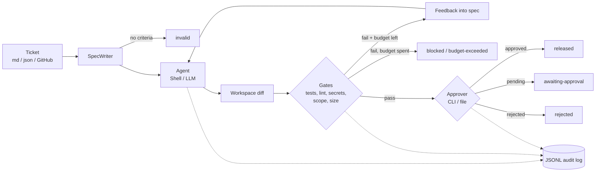

# agent-harness-starter

[](https://github.com/mikkoatienza/agent-harness-starter/actions/workflows/ci.yml)
 

A small, pluggable framework for running **coding agents** safely:

**ticket intake → spec → agent attempt → quality gates → retry with feedback → human approval → release**, with every step written to a JSONL audit log.

The harness around an agent (the spec it receives, the checks its output must pass, and who signs off) matters as much as the model. This package gives you that harness as plain, typed Python you can read in an afternoon and adapt to your own stack.

## Features
- **Ticket intake** from Markdown (with YAML front matter and checkbox acceptance criteria), JSON, or GitHub issues (`gh:owner/repo#123`).
- **Spec writers.** A template writer that refuses tickets without acceptance criteria, and an LLM writer that proposes criteria.
- **Agent runners.** `ShellAgent` wraps any CLI agent or script; `LLMAgent` does single-shot file edits through OpenAI or Anthropic.
- **Quality gates** set in YAML: any command (tests, lint, type-check, build), secret scan, diff scope (allow/deny globs), and size limits. You can register your own gate types.
- **Retries with feedback.** Gate failures are fed back into the spec for the next attempt.
- **Budgets.** Caps on attempts, tokens and wall-clock time.
- **Human approval.** A terminal prompt, or file-based approval for CI and chat-ops. Nothing is released by default.
- **Audit trail and reports.** A JSONL event log per run, plus a Markdown report for PR comments.
- **Offline mode.** Tests and examples run with no network and no API keys.

## Quickstart
```bash
pip install "git+https://github.com/mikkoatienza/agent-harness-starter"
# optional providers:  pip install "agent-harness-starter[openai] @ git+https://github.com/mikkoatienza/agent-harness-starter"

agent-harness init                       # writes a commented harness.yaml
agent-harness ticket ticket.md           # check how a ticket parses
agent-harness run ticket.md -c harness.yaml -w path/to/repo
agent-harness report path/to/repo/.harness/runs/<run>.jsonl
```
Exit codes for `run`: `0` released, `3` awaiting approval, `1` anything else.

### Try the end-to-end demo
```bash
git clone https://github.com/mikkoatienza/agent-harness-starter && cd agent-harness-starter
pip install -e ".[dev]"
python examples/run_demo.py
```
The demo copies a tiny project with a failing test and runs a scripted agent. The agent's first attempt is incomplete, so the tests gate blocks it. Its second attempt uses the gate feedback and passes. The run then waits for approval; after a reviewer approval file is dropped in, it releases.

## Architecture


| Module | Responsibility |
|---|---|
| `intake.py` | Parse tickets from Markdown, JSON, GitHub |
| `spec.py` | `SpecWriter` protocol: `TemplateSpecWriter`, `LLMSpecWriter` |
| `agents.py` | `Agent` protocol: `ShellAgent`, `LLMAgent` |
| `workspace.py` | Snapshot and diff the working tree, without needing git |
| `gates.py` | `Gate` protocol, built-in gates, registry |
| `approval.py` | `Approver` protocol: `CLIApprover`, `FileApprover` |
| `runner.py` | `Harness`: the loop, retries, budgets |
| `audit.py`, `report.py` | JSONL log, Markdown report |
| `llm.py` | `LLM` protocol: offline, OpenAI, Anthropic |

## Configuration
```yaml
agent:   {type: shell, command: "my-agent --spec {spec}"}   # the spec path is also in $HARNESS_SPEC
spec:    {type: template, constraints: ["Do not change public APIs"]}
gates:
  - {type: size, max_files: 15, max_lines: 400}
  - {type: scope, allow: ["src/*", "tests/*"], deny: [".github/*"]}
  - {type: secrets}
  - {type: command, name: lint,  run: "ruff check ."}
  - {type: command, name: tests, run: "pytest -q"}
  - {type: command, name: perf,  run: "make bench", blocking: false}   # warn only
approval: {type: file, directory: .harness/approvals}
budget:   {max_attempts: 3, max_tokens: 200000, max_seconds: 1800}
```
LLM providers are chosen with `provider:` or the `LLM_PROVIDER` env var (`offline`, `openai`, `anthropic`). API keys come from `OPENAI_API_KEY` / `ANTHROPIC_API_KEY`, and models can be overridden with `OPENAI_MODEL` / `ANTHROPIC_MODEL`. A shell agent can report token use by printing `HARNESS_TOKENS=<n>`.

## Extension guide
**Custom gate**
```python
from agent_harness.gates import GateContext, register_gate
from agent_harness.models import GateResult


class RequiresTests:
    name = "requires-tests"

    def check(self, ctx: GateContext) -> GateResult:
        ok = any(f.startswith("tests/") for f in ctx.changes.files)
        return GateResult(self.name, ok, "" if ok else "change has no tests")


register_gate("requires-tests", lambda cfg: RequiresTests())  # now usable in YAML
```
**Custom agent**: implement `run(spec, workdir) -> AgentResult`.
**Custom approver** (Slack, PR review, ...): implement `decide(spec, changes, gates) -> "approved" | "rejected" | "pending"`.
**Custom LLM**: implement `complete(prompt, *, system, max_tokens) -> Completion`.
Then compose in Python:
```python
from agent_harness.runner import Harness

Harness(agent=MyAgent(), gates=[...], approver=MyApprover()).run(ticket, Path("repo"))
```

## Roadmap
- Git-native mode: run each attempt on a branch and open a PR as the release step
- Parallel tickets with per-ticket worktrees
- Gate result caching and flaky-test retry policy
- Approver adapters for GitHub PR reviews and Slack
- Cost reporting per provider/model

## Development
```bash
pip install -e ".[dev]"
ruff check . && ruff format --check . && mypy && pytest
```
See [CONTRIBUTING.md](CONTRIBUTING.md) and [CHANGELOG.md](CHANGELOG.md).

## License
MIT © Mikko Atienza
